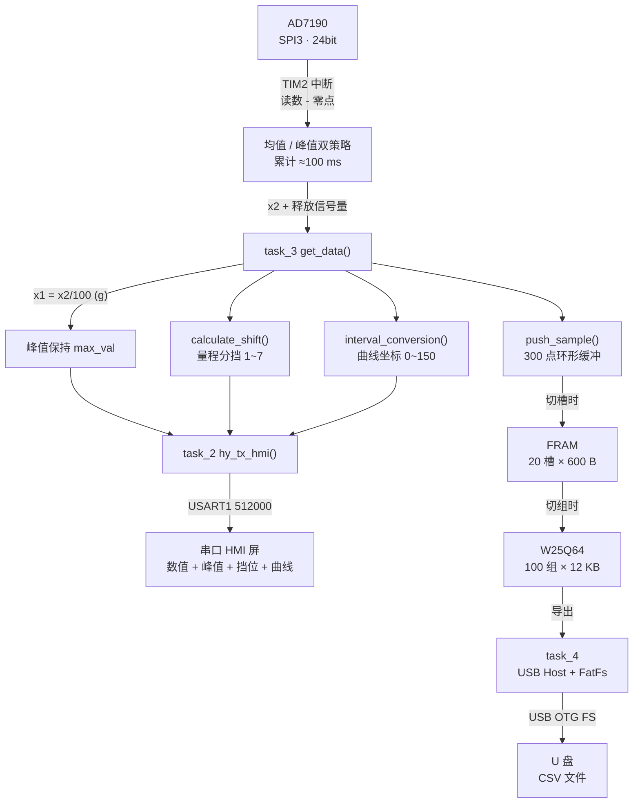

# GSM01A · 针刺测痛仪 / 爪抓力测量仪 主控固件

> 基于 **STM32F405RGT6 + RT-Thread** 的力值采集与控制固件，用于针刺测痛仪（ analgesy meter ）与爪抓力测量仪（ paw grip strength meter ）等动物行为学实验设备。
> 板卡代号 **mc01a**。

[]()
[]()
[]()
[]()
[](LICENSE)

---

## English Abstract

Firmware for a force-measurement instrument (needle-prick analgesy meter / paw grip strength meter). It samples a load cell through an **AD7190 24-bit Σ-Δ ADC at 100 Hz**, applies zeroing, peak-hold and auto range selection, streams live values and a 300-point waveform to a **serial HMI display**, stores each 300-point record in on-board **FRAM** (20 slots per group) and archives up to **100 groups** in a **W25Q64 SPI flash**, and exports data to a USB flash drive as CSV via **USB Host MSC + FatFs**. Built on **RT-Thread** with 5 application threads. Toolchain: Keil MDK-ARM 5.25 / ARMCC V5.06 update 6.

---

## 一、功能概览

| 功能 | 说明 |
|---|---|
| 高精度力值采集 | AD7190（24 位 Σ-Δ，增益 128，满量程 ±39.06 mV），采样率 100 Hz |
| 自动去皮 | 每次实验前采集多点取平均作为零点，消除零点漂移 |
| 峰值保持 | 记录本次实验的最大力值 |
| 自动量程分挡 | 7 挡（10 / 50 / 100 / 500 / 1000 / 3000 g 以上），挡位切换时自动重绘曲线 |
| 实时曲线 | 300 点波形实时推送至串口屏 |
| 双脚踏开关 | 左/右脚踏分别模拟"记录"与"清零"操作 |
| 数据分级存储 | 300 点/槽 → 20 槽/组（FRAM）→ 100 组（W25Q64 Flash） |
| U 盘导出 | USB Host + FatFs，导出为 CSV；U 盘未格式化时自动格式化 |
| 硬件看门狗 | IWDG，约 2 s 溢出，主循环喂狗 |
| 串口屏上电复位 | 上电主动向屏发送复位指令，避免屏状态残留 |

---

## 二、硬件平台

### 2.1 主控与时钟

| 项目 | 配置 |
|---|---|
| MCU | **STM32F405RGT6**（Cortex-M4F，LQFP64，1 MB Flash / 192 KB RAM） |
| 外部晶振 | HSE 25 MHz |
| PLL | M=25 / N=336 / P=2 / Q=7 |
| SYSCLK | **168 MHz**（APB1 42 MHz / APB2 84 MHz） |
| 系统时基 | TIM1 中断（`stm32f4xx_hal_timebase_tim.c`） |
| 调试接口 | SWD（CMSIS-AGDI / J-Link / ST-Link） |

### 2.2 外设资源分配

| 外设 | 引脚 | 速率 / 模式 | 连接对象 |
|---|---|---|---|
| **SPI3** | PB3 / PB4 / PB5，CS = **PB2** | Master，分频 16 | **AD7190** 24 位 ADC |
| **SPI2** | PB13 / PB14 / PB15，CS = **PC6** | Master，分频 2 | **W25Q64** SPI Flash（8 MB） |
| **SPI1** | PA5 / PA6 / PA7 | Master，分频 4 | **FRAM**（CS = PC0）与 **TMC5240**（CS = PA4）共用总线 |
| **USART1** | PA9 (TX) / PA10 (RX) | **512000** 8N1，RX 中断 | 串口 HMI 屏（Nextion/TJC 指令集） |
| USART2 | PA2 / PA3，DE = PA1 | 115200 8N1 | 预留（RS485 方向控制脚已分配，应用层未使用） |
| USART3 | PC10 / PC11 | 9600 8N1，中断已开 | 预留 |
| **USB OTG FS** | 内置 PHY | **Host Only** | U 盘（MSC 大容量存储类） |
| **TIM2** | — | 预分频 84-1 → 1 MHz | 采样节拍中断 |
| IWDG | — | LSI / 64，重装 1000（≈2 s） | 看门狗 |

### 2.3 GPIO 分配

| 引脚 | 名称 | 方向 | 用途 |
|---|---|---|---|
| PB10 / PB11 | LED1 / LED2 | 输出 | 状态指示（**低电平点亮**）；LED1 复用为 U 盘插入指示 |
| PB12 | HMI_EN | 输出 | 串口屏使能 |
| PD2 / PA15 | OUT1 / OUT2 | 输出 | 对外控制输出（预留） |
| PC5 / PC4 | M_EN / M_SLEEP | 输出 | 步进电机使能 / 休眠（预留） |
| PC1 / PC2 | FRAM_WP / FRAM_HOLD | 输出 | FRAM 写保护 / HOLD |
| PC0 | FRAM_CS | 输出 | FRAM 片选 |
| PC6 | FLASH_CS | 输出 | W25Q64 片选 |
| PA4 | SPI1_NSS | 输出 | TMC5240 片选 |
| PB2 | SPI3_NSS | 输出 | AD7190 片选 |
| **PB6 / PB7** | L_INT / R_INT | 输入 | 左 / 右脚踏开关（低电平有效） |
| PB8 / PB9 | SW1 / SW2 | 输入 | 按键（当前未使用） |

---

## 三、软件架构

### 3.1 目录结构

```
.
├── Core/                     STM32CubeMX 生成的用户代码层
│   ├── Inc/                  gpio / iwdg / main / spi / stm32f4xx_hal_conf
│   │                         stm32f4xx_it / tim / usart
│   └── Src/                  main.c 及各外设初始化、系统时钟、HAL 时基
├── Drivers/
│   ├── CMSIS/
│   │   ├── Include/          CMSIS Core（core_cm4.h 等）
│   │   └── Device/ST/STM32F4xx/Include/   stm32f4xx.h / stm32f405xx.h / system_stm32f4xx.h
│   └── STM32F4xx_HAL_Driver/ ST HAL 驱动（Inc + Src）
├── Middlewares/
│   ├── ST/STM32_USB_Host_Library/   USB 主机协议栈（Core + MSC 类）
│   └── Third_Party/
│       ├── FatFs/src/               FatFs R0.12c
│       └── RealThread_RTOS_RT-Thread/   RT-Thread 内核
├── RT-Thread/rtconfig.h      RT-Thread 裁剪配置
├── FATFS/                    FatFs 移植层（App / Target）
├── USB_HOST/                 USB 主机应用层（App / Target）
├── App/                      ★ 自研业务模块
│   ├── hy_ad7190/            AD7190 驱动（复位、寄存器、采样率、去皮）
│   ├── hy_kalman/            一维卡尔曼滤波
│   ├── hy_hmi/               串口屏通信、脚踏开关、下行命令解析
│   ├── hy_fram/              FRAM 缓存 + 组/槽数据管理
│   ├── hy_flash/             W25Q64 读写（含自动扇区擦除）
│   ├── hy_file/              FatFs 文件操作 + CSV 导出
│   ├── hy_pci/               GPIO 输出与 LED 指示
│   └── hy_tmc5240/           TMC5240 步进驱动（预留，当前未启用）
├── MDK-ARM/                  Keil 工程（mc01a.uvprojx / startup_stm32f405xx.s）
├── mc01a.ioc                 STM32CubeMX 工程配置
└── docs/                     架构与协议文档
```

### 3.2 线程模型（RT-Thread）

| 线程 | 入口 | 优先级 | 栈 | 节拍 | 职责 |
|---|---|---|---|---|---|
| `task_1` | `task1()` | **4** | 1024 | 10 ms | 解析串口屏下行指令；每约 1 s 轮询 USB 主机栈并刷新 `flash_access` |
| `task_2` | `hmi_uart()` | 10 | 1024 | 10 ms | 向串口屏推送状态与数据 |
| `task_3` | `get_data()` | 10 | 1024 | 信号量驱动 | 单位换算、峰值更新、量程分挡、曲线换算、写入环形缓冲 |
| `task_4` | `save_data_ing()` | 5 | 2048 | 100 ms | U 盘导出流程 |
| `pedal` | `pedal_thread_entry()` | 5 | 1024 | 10 ms | 双脚踏开关扫描与去抖 |
| main | RT-Thread user main | — | 4096 | 500 ms | 喂狗、翻转 LED2、调用 `MX_USB_HOST_Process()` |

线程间通过信号量 `dsem1` 同步：**TIM2 中断作为生产者，`task_3` 作为消费者。**

### 3.3 数据流



---

## 四、存储数据模型

采用 **"组（group）— 槽（slot）— 采样点"** 三级结构：

| 层级 | 容量 | 介质 | 说明 |
|---|---|---|---|
| 采样点 | 300 点 / 槽 | RAM 环形缓冲 | 单次实验波形，`int16_t`，单位 g |
| 槽 | 20 槽 / 组 | **FRAM**（12 KB 工作区） | 一组实验的 20 次记录 |
| 组 | 100 组 | **W25Q64**（`GROUP_DATA_ADDR(g) = g × 12 KB`，共 1.2 MB） | 长期归档 |

关键宏（`App/hy_fram/hy_fram.h`）：

```c
#define BLK_SZ          (300*2)              /* 单槽 600 字节 */
#define GROUP_SZ        20                   /* 每组 20 槽 */
#define TOTAL_GROUPS    100                  /* 共 100 组 */
#define GROUP_DATA_ADDR(g)  ((g)*12*1024)    /* Flash 中每组起始地址 */
```

**写回时机**：切换槽 → 写入 FRAM；切换组 → FRAM 整组（12 KB）回写 W25Q64，再把新组读入 FRAM。

**U 盘导出目录结构**：

```
0:/<实验名>/
├── <实验名>.csv            ← 屏幕表格数据（每次记录一行）
└── csv_file/
    ├── 01-01.csv           ← 第 1 组第 1 槽的 300 点原始波形
    ├── 01-02.csv
    └── ...
```

---

## 五、串口屏通信协议（摘要）

完整协议见 [`docs/串口屏通信协议.md`](docs/串口屏通信协议.md)。

### 5.1 MCU → 屏（Nextion/TJC 指令，均以 `FF FF FF` 结尾）

| 指令 | 含义 |
|---|---|
| `main.shift.val=%d` | 当前量程挡位（1~7） |
| `data.r_peak.val=%d` | 峰值力值（×10） |
| `data.r_real.val=%d` | 当前力值（×10） |
| `data.r_h0.val` / `data.r_h1.val` | 峰值 / 当前值柱状条高度（0~150） |
| `data.flash_access.val=%d` | U 盘是否插入 |
| `add s0.id,0,%d` | 波形控件追加一个点 |
| `cle s0.id,0` | 清空波形控件 |
| `addt s0.id,0,%d` + 300 字节 + `\x01` | 批量重绘整条曲线 |
| `click B_LOG,0` / `click B_ZERO,0` / `click p3,0` / `click get_list,0` | 模拟点击屏上按钮 |

### 5.2 屏 → MCU（帧头 `AA 55`，帧尾 `FF FF FF`）

| 命令字 | 子命令 | 功能 |
|---|---|---|
| `0x0A` | 0 | 开始一次采集（停表 → 清零 → 去皮 → 设采样率 → 清缓冲 → 启动 TIM2） |
| `0x0A` | 1 | 强制刷新曲线 |
| `0x0B` | 0 / 1 / 2 / 3 / 4 | 切换槽 / 删除槽 / 删除组 / 切换组 / 复位 FRAM |
| `0x0C` | 0 | 开始导出（携带 18 字节实验名） |
| `0x0C` | 1 | 结束导出 |
| `0x0C` | 2 | 收到一行表格数据（由 `task_4` 落盘并导出对应槽原始数据） |

---

## 六、编译与烧录

### 6.1 环境要求

| 项目 | 版本 |
|---|---|
| IDE | Keil **µVision 5**（推荐 ≥ 5.25） |
| 编译器 | **ARMCC V5.06**（AC5）。原始工程使用 update 6 (build 750)，实测 update 5 (build 528) 亦可编译；若使用 AC6 需自行调整兼容性 |
| Device Pack | Keil.STM32F4xx_DFP（≥ 2.15.0，当前工程记录为 2.17.0）+ ARM.CMSIS（≥ 5.2.0） |
| 配置工具（可选） | STM32CubeMX（用于重新生成 `Core/`，打开 `mc01a.ioc`） |

### 6.2 编译步骤

1. 用 Keil µVision 打开 `MDK-ARM/mc01a.uvprojx`；
2. 确认 Target 为 `mc01a`，Device 为 `STM32F405RGTx`；
3. 直接 **Build**（F7），输出位于 `MDK-ARM/mc01a/`：`mc01a.axf` / `mc01a.hex`；
4. 通过 SWD 下载（已配置 `Create HEX File`）。

### 6.3 编译宏

```
USE_HAL_DRIVER, STM32F405xx
```

### 6.4 资源占用（参考）

```
Program Size: Code=45514  RO-data=1226  RW-data=332  ZI-data=37316
Flash ≈ 46.7 KB / 1024 KB        RAM ≈ 37.6 KB / 128 KB
```

---

## 七、仓库裁剪说明

本仓库已从完整开发目录中**剔除全部编译产物与个人配置**，仅保留可编译、可追溯的源码：

**已移除（约 100 MB / 3300 个文件）**

| 内容 | 说明 |
|---|---|
| `MDK-ARM/mc01a/` | 编译输出（`.o` `.crf` `.axf` `.hex` `.map` `.htm` `.dep` 等，约 100 MB） |
| `MDK-ARM/*.uvguix.*` | Keil 界面布局，含开发者用户名 |
| `MDK-ARM/*.lst` | 汇编列表文件（可由编译重新生成） |
| `Drivers/CMSIS/DSP`、`NN`、`Core_A`、`DAP`、`RTOS`、`RTOS2` | CMSIS 扩展组件，本工程未使用（约 12 MB） |
| `Drivers/CMSIS/Device/ST/STM32F4xx/Source` | 各工具链启动文件模板，本工程使用自带启动文件 |
| `Drivers/CMSIS/Device/ST/STM32F4xx/Include/` 中非 F405 的芯片头文件 | 仅保留 `stm32f4xx.h` / `stm32f405xx.h` / `system_stm32f4xx.h`（节省约 24 MB） |
| `Middlewares/Third_Party/FatFs/src/option/cc*.c`、`unicode.c` | `ffconf.h` 中 `_USE_LFN = 0`，码表文件不参与编译 |
| `*.rar` 版本快照 | 历史打包文件 |

> **如需恢复**：用 STM32CubeMX 重新打开 `mc01a.ioc` 生成一次代码即可补齐 CMSIS 与 HAL 全集；或从 Keil Pack 目录复制。当前保留的 `Drivers/STM32F4xx_HAL_Driver` 为**完整 Inc + Src**，新增外设无需额外补文件。

**保留**：`Core/`、`Drivers/`（HAL 全集 + 最小 CMSIS）、`Middlewares/`、`FATFS/`、`USB_HOST/`、`App/`、`MDK-ARM/`（工程文件 + 启动文件）、`mc01a.ioc`、`.mxproject`。

---

## 八、版本沿革

> 依据源文件时间戳与打包快照整理，非正式变更记录。

| 版本 / 时间 | 主要内容 |
|---|---|
| **2026-04-07** | 新增 IWDG 硬件看门狗（≈2 s）；新增串口屏上电复位 `hmi_res()`；按实测数据重新标定（灵敏度 ≈ 1096 计数/g）；采样率提升至 1000 Hz；关闭卡尔曼滤波，改用多点平均降噪 |
| 2025-11-19 | FRAM 组/槽数据模型、CSV 导出流程、双脚踏开关功能定版 |
| 2025-09 ~ 10 | 集成 FatFs + USB Host + RT-Thread，串口屏通信框架建立 |
| 2025-01 ~ 02 | 早期驱动模块（`hy_pci` / `hy_tmc5240` / `hy_kalman`）与硬件接口定义 |

详见 [`CHANGELOG.md`](CHANGELOG.md)。

---

## 九、已知问题与待办

4 项 P0 缺陷已于 2026-10-14 修复（缓冲区越界、收帧索引越界、`strchr` 未判空、TIM2 中断超时），详见 [`docs/待办与已知问题.md`](docs/待办与已知问题.md)。

剩余待办按优先级分为两类：

- **P1 · 健壮性与实时性**：跨执行流共享变量未加 `volatile`、全局 `buf` 无保护、`ram` 结构体并发访问、串口发送阻塞、USB 轮询入口分散、掉电丢失当前组数据
- **P2 · 可维护性**：标定常数硬编码、Magic Number 遍布、注释与实现不符、死代码、`hy_hmi.c` 剩余 `sprintf`、缺少单元测试

---

## 十、开发约定

1. **所有自研代码必须写在 `/* USER CODE BEGIN */ ... /* USER CODE END */` 区块内**，以便用 CubeMX 重新生成 `Core/` 时不丢失。
2. 自研模块统一放在 `App/` 下，按 `hy_<外设或功能>` 命名，一个模块一个目录（`.c` + `.h`）。
3. **源文件编码为 UTF-8 with BOM**（中文注释）。Keil µVision、VS Code 与 GitHub 网页均可正确显示。新增文件请保持该编码；`Drivers/` 与 `Middlewares/` 下的官方中间件保持原始编码，请勿转换。
4. 新增源文件后需同步更新 `MDK-ARM/mc01a.uvprojx` 的分组与头文件包含路径。

---

## 十一、许可与声明

本项目采用 **MIT 许可证**，详见 [`LICENSE`](LICENSE)。你可以自由使用、修改、分发与商用，只需保留版权声明。

仓库内含的第三方组件（STM32 HAL、CMSIS、ST USB Host Library、FatFs、RT-Thread）版权归各自作者所有，其许可条款与本项目兼容，详见 [`LICENSE`](LICENSE) 末尾的第三方组件说明。
