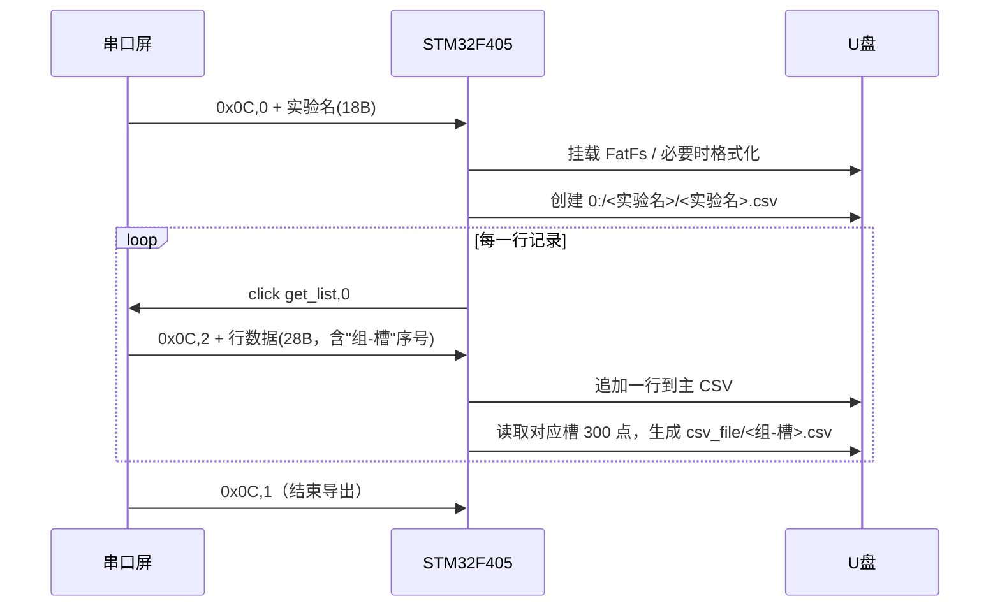

# 串口屏通信协议

**物理层**：USART1，**512000 bps**，8 位数据位、1 位停止位、无校验
**实现位置**：`App/hy_hmi/hy_hmi.c`
**屏类型**：串口 HMI（Nextion / TJC 指令集兼容）

---

## 一、下行方向：MCU → 屏

采用串口屏标准指令格式，**每条指令以三个 `0xFF` 字节结尾**（`\xff\xff\xff`）。

### 1.1 数值显示指令

| 指令模板 | 含义 | 触发时机 | 数值范围 |
|---|---|---|---|
| `main.shift.val=%d\xff\xff\xff` | 当前量程挡位 | 挡位发生变化时 | 1 ~ 7 |
| `data.r_peak.val=%d\xff\xff\xff` | 峰值力值（**×10**，保留一位小数） | 每 100 ms | — |
| `data.r_real.val=%d\xff\xff\xff` | 当前力值（**×10**） | 每 100 ms | — |
| `data.r_h0.val=%d\xff\xff\xff` | 峰值对应的柱状条高度 | 每 100 ms | 0 ~ 150 |
| `data.r_h1.val=%d\xff\xff\xff` | 当前值对应的柱状条高度 | 每 100 ms | 0 ~ 150 |
| `data.flash_access.val=%d\xff\xff\xff` | U 盘插入状态（供屏上指示灯） | 每 100 ms | 0 / 1 |

柱状条高度换算（以当前值为例）：

```c
(uint8_t)((x1 + 750) / 7500 * 150)      /* 挡位 7 时满量程 ±7500 g 映射到 0~150 */
(uint8_t)((max_val + 750) / 7500 * 150) /* 峰值同理 */
```

### 1.2 曲线绘制指令

| 指令模板 | 含义 |
|---|---|
| `add s0.id,0,%d\xff\xff\xff` | 向波形控件 `s0` 追加一个点（值为 `interval_conversion()` 换算后的 0~150） |
| `cle s0.id,0\xff\xff\xff` | 清空波形控件 |
| `addt s0.id,0,%d\xff\xff\xff` | 声明即将批量追加 N 个点（N = 环形缓冲中有效点数） |
| `<单字节>` | 批量追加阶段逐字节发送的曲线数据（共 N 个字节） |
| `\x01\xff\xff\xff` | 批量追加结束标记 |

**批量重绘流程**（挡位切换或重新显示历史曲线时调用 `addt()`）：

```
1. 发送 "addt s0.id,0,<N>\xff\xff\xff"
2. 等待 80 ms（等屏响应）
3. 连续发送 N 个单字节曲线值（每个字节单独一次 UART 发送，无结束符）
4. 发送 "\x01\xff\xff\xff" 结束
```

> 注：步骤 3 中每个曲线值都是独立的一次 `HAL_UART_Transmit()` 调用，字节间由 UART 硬件保证时序连续。

### 1.3 按钮模拟指令

脚踏开关按下时，MCU 通过模拟点击让屏执行对应动作：

| 指令 | 含义 | 触发源 |
|---|---|---|
| `click B_LOG,0\xff\xff\xff` | 点击"记录"按钮 | 左脚踏（PB6） |
| `click B_ZERO,0\xff\xff\xff` | 点击"清零"按钮 | 右脚踏（PB7） |
| `click p3,0\xff\xff\xff` | 跳转到页面 3（采集页面） | 收到开始采集命令后 |
| `click get_list,0\xff\xff\xff` | 触发屏刷新列表并回传下一行数据 | 导出过程中 |

---

## 二、上行方向：屏 → MCU

### 2.1 帧格式

```
┌────────┬────────┬─────────┬─────────┬─────────┬───────────────────┐
│  0xAA  │  0x55  │ 命令字  │ 参数... │ 0xFF    │ 0xFF    │ 0xFF  │
└────────┴────────┴─────────┴─────────┴─────────┴─────────┴───────┘
  帧头（2 字节）        命令体（≤28 字节）        帧尾（3 字节）
```

- **接收缓冲区**：`g_usart_rx_buf[30]`（即命令体最大 30 字节）
- **接收方式**：逐字节中断接收（`HAL_UART_RxCpltCallback`），状态机解析
- **状态机标志**：`g_usart_rx_sta`
  - `0x8000` — 已收到帧头 `AA 55`
  - `0x4000` — 已收到第一个 `0xFF`
  - `0x1000` — 已收到第二个 `0xFF`
  - `(g_usart_rx_sta & 0xE000) == 0xE000` — 帧接收完成
  - 低 12 位（`& 0x0FFF`）为当前写入索引
  - 出现非预期字节时 `g_usart_rx_sta = 0` 复位状态机

> ⚠ 当前实现**未对写入索引做上限检查**，若收到超过 30 字节且无帧尾的帧，会越界写入。详见 `待办与已知问题.md`。

### 2.2 命令字 `0x0A` —— 采集控制

| 参数 `buf[1]` | 参数 `buf[2]` | 功能 |
|---|---|---|
| `0` | 采样率档位（当前被 `sampling_rate()` 内部覆盖，实际锁定 100 Hz） | **开始一次采集** |
| `1` | — | 强制刷新曲线显示（置 `last_shift = 0`） |

**开始采集的完整时序**：

```
1. HAL_TIM_Base_Stop_IT(&htim2)          停止采样节拍
2. 清零所有测量变量（x1/x2/x3/max_val/v_data/temp_val/mean_val）
3. hy_kalman_init()                      复位滤波器
4. zero = get_tare_value()               重新去皮（丢弃 160 点 + 20 点平均，约 2~4 s）
5. sampling_rate(buf[2])                 设置采样率与中断节拍
6. ram.wr_idx = 0; ram.cnt = 0;          清空曲线环形缓冲
7. 发送 "click p3,0"                     通知屏跳转到采集页面
8. HAL_TIM_Base_Start_IT(&htim2)         启动采样
```

### 2.3 命令字 `0x0B` —— 数据槽 / 组管理

| 参数 `buf[1]` | 参数 | 功能 | 调用函数 |
|---|---|---|---|
| `0` | — | 切换槽（存当前槽并进入下一槽），同时清零测量变量 | `user_switch_slot()` |
| `1` | `buf[2]` = 槽号 | 删除指定槽 | `user_delete_slot()` |
| `2` | — | 删除整组（清空 FRAM 工作区） | `user_delete_group()` |
| `3` | `buf[2]` = 组号（1 起）、`buf[3]` = 当前槽 | 切换组（旧组回写 W25Q64，新组读入 FRAM） | `user_switch_group()` |
| `4` | — | 复位 FRAM 工作区 | `fram_init()` |

### 2.4 命令字 `0x0C` —— 数据导出

| 参数 `buf[1]` | 参数 | 功能 |
|---|---|---|
| `0` | `buf[2..19]` = 实验名（**18 字节**） | 开始导出：置 `export_start = 1`，保存实验名，向屏请求列表 |
| `1` | — | 结束导出：置 `export_start = 0`，重启 TIM2 |
| `2` | `buf[2..29]` = 表格行数据（**28 字节**） | 收到一行表格数据 → 由 `task_4` 写入主 CSV，并按序号导出该槽的 300 点原始波形 |
| 其他 | — | 停止 TIM2 |

**导出交互流程**：



---

## 三、脚踏开关

| 引脚 | 名称 | 有效电平 | 去抖 | 映射动作 |
|---|---|---|---|---|
| PB6 | L_INT | 低 | 连续 5 次采样（≈50 ms）一致 | 发送 `click B_LOG,0` |
| PB7 | R_INT | 低 | 同上 | 发送 `click B_ZERO,0` |

实现见 `hy_pedal_press()`：采用"按下确认 + 释放确认"双边沿状态机，避免长按重复触发。

---

## 四、实现位置索引

| 功能 | 函数 | 文件 |
|---|---|---|
| 下行指令发送 | `hy_tx_hmi()` | `App/hy_hmi/hy_hmi.c` |
| 曲线批量重绘 | `addt()` | 同上 |
| 脚踏扫描 | `hy_pedal_press()` | 同上 |
| 量程分挡 | `calculate_shift()` | 同上 |
| 曲线坐标换算 | `interval_conversion()` | 同上 |
| 上行帧解析 | `receive_data_parse()` | 同上 |
| 字节接收状态机 | `HAL_UART_RxCpltCallback()` | 同上 |
| 导出流程 | `export_data()` | 同上 |
| 屏上电复位 | `hmi_res()` | 同上 |
